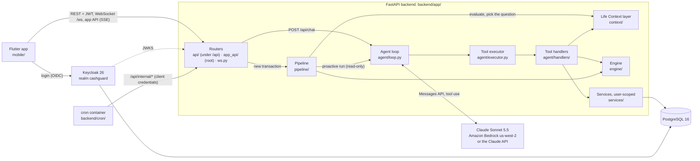

# CashGuard

**A money coach that judges each purchase against your life, not against a budget table.**

[](https://github.com/David3761/CashGuard/actions/workflows/ci.yml)
[](LICENSE)

Built at **VibeHack 2026 (NEXXT AI Hackathon × Raiffeisen Bank)**, track *AI for Scaling & Growth*: "an AI agent that actively helps an individual navigate financial decisions, beyond a basic search interface or a fixed decision tree".

## The problem

Young people want to reach a goal (an emergency fund, a summer holiday, a car deposit) but don't have a real picture of their money. Banking apps see transactions, not the life behind them. They say "you spent 500 lei at Mega Image" and stop there. They can't tell whether that was a binge, a planned purchase or a shared lunch you paid for the whole team.

## What makes CashGuard different

1. **Purchases are judged against the person's life.** Each user has a Life Context: occupation, household, home, hobbies, plans. Every life fact expands into **spending signatures**: what that life normally buys, where, how much and when. Every transaction gets a **life-fit score** against those signatures before anything is flagged.
   - The same 4,500-lei TV is a work tool for Andrei, a sports analyst, so he gets a quiet card. For Bianca, a student, it's a gentle question.
   - The same 350 lei at Shop&Go is normal for Ioana's family of four and unusual for Matei, who lives alone.
2. **It asks one question, only when the life doesn't explain the purchase.** It asks at most once a day, never during quiet hours, and backs off when you ignore it. It never uses judgmental wording, which is enforced in code. It learns from the answers: once every Friday is "team lunch", it stops asking.
3. **The plan re-plans when the context changes.** Any of these recomputes the daily budget and the Monte Carlo goal forecast in the same tool call:
   - an answer to a question,
   - a new fact ("I moved, the rent is 2,400"),
   - a volunteered plan ("holiday in August, about 3,000 lei"),
   - a slip.

   Claude then reports the change with the engine's numbers, e.g. "76 % instead of 70 %".
4. **Built for voice.** The chat takes `input_mode: "voice"`, and every reply carries a `speak_text`: at most two plain sentences, with percentages and amounts spelled out for text-to-speech (`backend/app/agent/language.py`). The language (Romanian or English) is detected per message. The Flutter app doesn't have a microphone or TTS yet: today it's text chat, streamed over SSE.

The chain: **life facts → signatures → life-fit → decision (ignore / auto / inform / ask) → one question → the answer becomes tool calls → re-plan.**

## Demo: Scene A, "I bought for my colleagues too"

Matei is a junior developer who lives alone in București and is saving 10,000 lei by 31 December. At 13:05 he pays **500 lei at Mega Image**. That's about 6× his usual 85-lei basket, and nothing in his life explains it.

| # | What happens | Where in the code |
|---|---|---|
| 1 | `POST /api/sim/transaction {"scenario_id": "matei_mega_500"}` feeds the bank text `MEGA IMAGE 0451 BUCURESTI` | `backend/data/scenarios/matei_mega_500.json`, `backend/app/api/sim.py` |
| 2 | The pipeline normalises the merchant (`mega_image`, groceries) and scores the transaction against his signatures: the decision is **ask**. The question policy grants today's one question | `backend/app/pipeline/processor.py`, `backend/app/context/evaluate.py`, `backend/app/context/questions.py` |
| 3 | A **proactive** agent run with read-only tools writes the question, plus a `speak_text` version for voice | `backend/app/agent/proactive.py` |
| 4 | Matei answers: *"Am luat și pentru colegi, suntem cinci."* ("I bought for my colleagues too, there are five of us.") | `POST /api/chat` |
| 5 | Claude calls `annotate_transaction` with `purpose: "on_behalf_of_others"`, `beneficiary: "shared"`, `people_count: 5`, `others_will_repay: true` and `debtor_label: "colegi"`. **The code, not Claude**, works out the split: a real expense of **100.00 lei** and a **400.00-lei receivable** (4 × 100). The plan and the forecast are recomputed in the same call | `backend/app/agent/handlers/transactions.py`, `backend/app/agent/executor.py` |
| 6 | Claude calls `offer_payment_request`. This adds a tap card, *"Trimite cererea (4 × 100 lei)"* ("Send the request"), and sends nothing by itself | `backend/app/agent/handlers/receivables.py` |
| 7 | The reply: *"Am înțeles! Cheltuiala ta reală e 100 de lei. Ai 400 de lei de recuperat de la colegi."* ("Got it! Your real expense is 100 lei. You have 400 lei to get back from your colleagues.") | `backend/app/agent/loop.py` |

The whole scene runs through the real snapshot, tool schemas, executor and agent loop with a scripted LLM in [`backend/tests/unit/agent/test_scene_a.py`](backend/tests/unit/agent/test_scene_a.py), where the transaction id is 918. The goal probabilities come from the real engine on the committed persona data and are pinned in [`backend/tests/acceptance/test_demo_numbers.py`](backend/tests/acceptance/test_demo_numbers.py): **79 %** before the purchase, **70 %** right after it, and **76 %** once the answer is in (0.7879 → 0.6982 → 0.7590).

On the running stack the same tool calls write to Postgres: the transaction's effective amount, the receivable, the new plan version and the forecast. The app receives them as WebSocket events (`plan.updated`, `forecast.updated`). The same flow on Postgres is tested in [`backend/tests/db/test_agent_pg_ports.py`](backend/tests/db/test_agent_pg_ports.py), and it was run live on Amazon Bedrock on 2026-10-29: Matei's 500 lei became 100 lei, with a 400-lei receivable from 5 colleagues.

**More scenes** (all in [`backend/data/scenarios/`](backend/data/scenarios/)):

| Scene | Scenario | What it shows |
|---|---|---|
| B | `andrei_tv` vs `bianca_tv` | The same 4,500-lei eMAG TV: a quiet *inform* card for the sports analyst, a gentle question for the student |
| C | `matei_flight` | 900 lei at Wizz Air is drawn from his "Vacanță august" pot, with no question |
| D | `matei_friday_lunch` | 95 lei on a Friday at lunch is explained by his Friday team-lunch rule (seeded as if it had been learned), with no question |
| E | `ioana_shopgo_350` vs `matei_shopgo_350` | The same 350 lei: *auto* for a family of four (household scale 2.1), a question for one person |

## Architecture



- **Agent** (`backend/app/agent/`)
  - `tools.py`: 40 tool schemas, built once per run and filtered by trigger. Up to 20 are sent as `strict`, which is the API's limit.
  - `executor.py`: the executor and its security rules. The handlers live in `handlers/`.
  - `snapshot.py`: the context snapshot.
  - `prompts.py`: the RO/EN prompts.
  - `style.py`: the banned-phrase checker.
  - `templates.py` and `fallbacks.py`: the templates and the deterministic fallbacks.
  - `language.py`: language detection and `speak_text`.
- **Life Context** (`backend/app/context/`). Every module is pure, with `today` passed in:
  - `normalize.py`: merchant normalisation.
  - `library.py`: the signature library (45 entries, in `backend/data/signature_library.json`).
  - `life_fit.py`: the life-fit score and its "because".
  - `evaluate.py`: the evaluation.
  - `questions.py`: the question policy.
  - `rules.py`: learning rules.
  - `propagate.py`: propagation when a fact changes.
  - `inference.py`: hypotheses inferred from history, never sensitive ones.
  - `calendar_events.py`: the Romanian calendar, including Orthodox Easter.
  - `products.py`: product ranking by context.
- **Engine** (`backend/app/engine/`)
  - The daily budget, the ledger, and baselines with the OECD household scale.
  - Anomaly features.
  - A **10,000-path Monte Carlo** goal forecast (`forecast.py`).
  - What-if simulation, plus drivers and options (it never cuts essentials).
  - Pots and auto-save.
- **Platform**
  - `backend/app/api/`: the FastAPI routers.
  - `backend/app/app_api/`: the root-level app API for the Flutter app.
  - `backend/app/auth.py`: Keycloak JWT/JWKS auth.
  - `backend/app/db/` and `backend/migrations/`: SQLAlchemy models and Alembic migrations.
  - `backend/app/pipeline/`: the ingest → evaluate → apply → recompute → question pipeline.
  - `backend/app/ws.py`: the WebSocket push after each commit.
  - `backend/app/sim/`: the simulator.
  - `backend/app/security/`: rate limits and HTTP hardening.
  - `backend/app/push/`: FCM push.
  - `backend/cron/`: the cron jobs.

The full design is in [`backend/docs/savings-coach-backend-architecture.md`](backend/docs/savings-coach-backend-architecture.md).

## Tech stack

| Layer | Technology |
|---|---|
| Backend | Python 3.12, FastAPI, Pydantic v2, uvicorn (one worker, because the WebSocket manager is in memory) |
| AI | Claude Sonnet 5.5 (`claude-sonnet-5-5`) through the Anthropic Python SDK (`anthropic[bedrock]`). It runs on **Amazon Bedrock** (`us-west-2`, cross-region inference profile `us.anthropic.claude-sonnet-5-5`, Bedrock API key) or on the Claude API. It uses tool use with strict schemas, streaming, and effort `low` |
| Maths | numpy for the Monte Carlo forecast. Money is `Decimal` with half-up rounding (`backend/app/domain/money.py`) |
| Data | PostgreSQL 16, SQLAlchemy 2 (async) with psycopg 3, Alembic |
| Auth | Keycloak 26.5 (OIDC), with RS256 JWTs checked by PyJWT. Three clients: `savings-frontend`, `savings-dev` and `savings-cron` |
| Mobile | Flutter (Dart ≥ 3.13), Riverpod, Chopper, Drift, Firebase Cloud Messaging |
| Ops | Docker Compose (db, db-test, keycloak, api, cron). When hosted, Caddy provides TLS (`backend/deploy/`) |
| Quality | uv (locked), ruff, mypy (strict on the cores), pytest with hypothesis and coverage, GitHub Actions (with pip-audit), pre-commit, gitleaks |

## Quick start

You need Docker with Compose. For local development you also need Python 3.12 and [uv](https://docs.astral.sh/uv/), and Flutter for the app.

### 1. Settings (`backend/.env`)

```bash
cd backend
cp .env.example .env        # gitignored; every variable is listed and explained in the file
```

The stack runs without any key. Claude calls then fall back to template replies, and the demo's quick-reply chips go through deterministic fallbacks (`backend/app/agent/fallbacks.py`). For real Claude, set **one** of these in `backend/.env`:

```dotenv
# Amazon Bedrock (what we demo on)
LLM_PROVIDER=bedrock
AWS_DEFAULT_REGION=us-west-2
AWS_BEARER_TOKEN_BEDROCK=<your Bedrock API key>   # or AWS_ACCESS_KEY_ID / AWS_SECRET_ACCESS_KEY / AWS_SESSION_TOKEN

# or the Claude API
LLM_PROVIDER=anthropic
ANTHROPIC_API_KEY=<your key>
```

Never commit `.env`. The `.env.example` file holds only empty or dev-only values, and a test keeps it in sync with `backend/app/config.py`.

### 2a. Everything in Docker (one command)

```bash
cd backend && scripts/smoke_local.sh
```

The script:

- builds and starts Postgres, Keycloak, the API and cron;
- seeds the five personas;
- gets a token for `matei`;
- checks `/api/me`, `/api/state` and the internal-role guard (a user token on `/api/internal` gets a 403);
- fires Scene A's transaction.

Then:

- API docs: http://localhost:8000/api/docs (on in dev: `API_DOCS_ENABLED=true`)
- Keycloak: http://localhost:8081. The personas are `matei`, `andrei`, `bianca`, `ioana`, `alex` and `elena`, with the dev password `cashguard-dev`. They also have the `sim` role, so they can drive the simulator.
- `elena` is the heavy persona: 4 years of history (5,332 transactions), plus chat history, transfers, receivables, life events, reflections and notifications (`backend/scripts/build_elena.py`). To see her in the Flutter app, set `APP_API_USER=a0000000-0000-4000-8000-000000000006` in `backend/.env`.

### 2b. Local API with hot reload

```bash
cd backend
make install                                   # uv sync --locked
docker compose up -d --wait db keycloak        # Postgres on :5434, Keycloak on :8081
uv run alembic upgrade head && uv run python -m app.db.seed --reset
make dev                                       # http://localhost:8000/api/health → {"status":"ok"}
```

To get a user token for curl:

```bash
TOKEN=$(curl -s -d grant_type=password -d client_id=savings-dev -d username=matei -d password=cashguard-dev \
  http://localhost:8081/realms/cashguard/protocol/openid-connect/token | python3 -c 'import sys,json; print(json.load(sys.stdin)["access_token"])')
curl -H "Authorization: Bearer $TOKEN" http://localhost:8000/api/state
```

### 2c. The Flutter app

The app talks to the root-level **app API**. It's mounted when `APP_API_ENABLED=true`, which `.env.example` already sets, and it speaks as the demo user Matei.

```bash
cd mobile && flutter pub get
flutter run --dart-define=USE_MOCK_API=false --dart-define=API_BASE_URL=http://10.0.2.2:8000   # Android emulator
```

On a physical device, run `adb reverse tcp:8000 tcp:8000` and pass `--dart-define=API_BASE_URL=http://localhost:8000`. The defines are read in `mobile/lib/core/request/api_config.dart`. Without `USE_MOCK_API=false`, the app shows mock data.

When the server sets `APP_API_KEY` (the hosted overlay requires it), build the app with the same value: `--dart-define=APP_API_KEY=<key>`. Every app request then sends it as `X-App-Key`; without it the app API answers 401. Locally it's unset and the app API is open.

## Tests

```bash
cd backend
make db-up       # throwaway Postgres on :5435 (tmpfs) for the db / api / ws suites
make check       # lock check + ruff + mypy + every non-live test, with coverage (CI runs the same)
make test-all    # also the live tests against real Claude (costs money)
```

**4,167 tests pass** (94 % coverage), plus 6 live tests that run only when asked:

| Suite | Tests | Needs |
|---|---|---|
| `tests/unit` + `tests/infra` | **3,589 passed** in ~25 s (`uv run pytest -q --no-cov tests/unit tests/infra`) | nothing |
| `tests/acceptance` (the demo numbers) | 6 passed | nothing |
| `tests/db` · `tests/api` · `tests/ws` | 351 · 207 · 14 passed | Postgres (`make db-up`); CI starts it as a service |
| `tests/eval` (live) | 6, opt-in (`-m live`) | a real Claude key |

What the suites cover:

- **Unit and property tests** (hypothesis) for the money helpers, the engine and the context layer.
- **Golden tests** for the data files, the prompts and the demo probabilities.
- **Architecture tests** that ban wall-clock reads outside `app/clock.py`.
- **The Scene A test**, end to end.
- **The AI red-team suite.**
- **DB, API and WebSocket tests** against a real Postgres.

## AI safety and responsible AI

**Claude only proposes tool calls. The backend decides what runs.** Every control is enforced in code, where the model's output turns into an effect.

- The full threat model, mapped to the OWASP Top 10 for LLM applications, is in [`backend/docs/ai-safety.md`](backend/docs/ai-safety.md). It has 34 controls, each with the test that proves it.
- The red-team suite is [`backend/tests/unit/agent/test_ai_safety.py`](backend/tests/unit/agent/test_ai_safety.py). A scripted LLM makes the calls that a jailbroken or injected model would make, and the real snapshot, executor, handlers and loop answer them.

The controls, in summary:

| Guard rail | Where | What it does |
|---|---|---|
| Tool whitelist | `execute_tool` in `backend/app/agent/executor.py` | Only registered tools run. They're looked up by dict key, never through `getattr` or `eval`. Anything else gets `unknown_tool`. The loop also refuses a tool the run wasn't offered (`backend/app/agent/loop.py`) |
| User scoping | `backend/app/agent/executor.py`, `ToolInput` in `backend/app/agent/tools.py`, `backend/app/agent/ports.py`, `owned()` in `backend/app/services/_common.py` | `user_id` is never a tool input. An input that carries one is refused, and the user comes from the backend. Inputs are frozen Pydantic models with `extra="forbid"`. Another user's row gives `not_found`, exactly like a missing row, and the suite tries 13 foreign-id attacks |
| Validated inputs | `backend/app/agent/executor.py`, `backend/app/agent/llm.py` | A bad input becomes `invalid_input` with the field names and never the values (24 cases). A cut-off streamed tool input is never run on a guess. Any other exception becomes a generic `internal_error`, and the loop goes on |
| Read-only proactive runs | `tools_for` in `backend/app/agent/tools.py`, `allowed_in_proactive` in `backend/app/agent/executor.py`, `backend/app/agent/proactive.py` | When the agent starts the conversation, it gets only read tools (`get_*`, `simulate_plan`, `suggest_savings_products`, `show_quick_replies`, `mark_event_handled`). This is checked twice, and every one of the 31 write tools is tested. Claude has 15 s, after which a template question is sent. Nothing changes until the user answers |
| Bounded runs | `backend/app/agent/loop.py`, `backend/app/agent/llm.py`, `backend/app/config.py` | Each run allows `MAX_AGENT_ITERATIONS` = 6 Claude calls, `MAX_TOOL_CALLS_PER_RUN` = 16 tool calls (parallel batches included), and 60 s in total waiting for Claude (`CHAT_RUN_TIMEOUT_S`). User text is capped at 4,000 characters. Each call gets `max_tokens`, a 30 s stream timeout and 2 retries. `LLM_MAX_CONCURRENCY` = 4 Claude calls run per process, and the rest queue |
| Refusals and outages | `backend/app/agent/loop.py`, `backend/app/agent/templates.py`, `backend/app/agent/fallbacks.py` | Only `end_turn` text is shown. A `refusal`, a `max_tokens` stop or an error gets a fixed template. If Claude is down, the known quick replies ("Doar pentru mine", "5", …) run the same tool calls through the same executor, and anything else changes nothing |
| Tone | `find_banned` in `backend/app/agent/style.py` | Judgmental Romanian and English phrases are blocked after folding case, diacritics and look-alike letters. A hit regenerates the reply once; a second hit gives the template |
| Prompt injection | `backend/app/agent/snapshot.py`, `backend/app/agent/prompts.py`, `backend/app/context/library.py` | Merchant names, items, descriptions and notes enter the snapshot as quoted JSON strings on one line, capped at 120 characters. The system prompt is two frozen blocks with no user data in them. The rules say data is never instructions and forbid revealing the prompt. Signatures that Claude proposes are field-whitelisted, capped at 8, with a strength of at most 0.9 |
| Sensitive data | `backend/app/agent/snapshot.py`, `backend/app/context/evaluate.py`, `backend/app/context/inference.py`, `backend/app/logging.py` | IBANs and card numbers are scrubbed before anything reaches Claude. Health spending is never asked about and never used for a hypothesis, and there's no sensitive fact type. Logs redact Anthropic keys, AWS and Bedrock keys, Bearer tokens, JWTs, URL passwords and IBANs |
| Not annoying | `backend/app/context/questions.py` | At most 1 question a day and 4 a week, quiet hours from 22:00 to 08:00, back-off after two ignored questions, and suppress rules ("don't ask about this again") |
| Rate limits and abuse | `backend/app/security/ratelimit.py`, `backend/app/api/chat.py`, `backend/app/app_api/router.py`, `backend/app/ws.py`, `backend/app/security/http_hardening.py` | Chat is limited to 10 messages a minute and 200 a day per user, with `429` + `Retry-After`. The simulator allows 30 calls a minute and WebSocket connects 10 a minute. One reply runs at a time per user (`409 agent_busy`, race-free). Messages are capped at 2,000 characters. Bodies over 64 KiB get a 413. Each user gets at most 3 sockets with 4 KiB frames. Security headers are set. Tests: `backend/tests/unit/security/test_ratelimit.py`, `backend/tests/api/test_chat_limits.py`, `backend/tests/api/test_hardening.py`, `backend/tests/ws/test_ws_limits.py` |
| Auth | `backend/app/auth.py` | Keycloak JWTs are RS256 only: `alg=none` and HS256 are rejected. The JWKS signature, issuer, `azp`/audience and `exp`/`nbf` are all checked. `/api/internal/*` needs the `internal` role, which only the confidential cron client has. `/api/sim/*` is mounted only with `SIM_MODE=true` and needs the realm role `sim` (`backend/tests/api/test_sim.py`) |
| Money | `backend/app/agent/tools.py`, `backend/app/agent/handlers/shaping.py`, `backend/app/api/transfers.py` | **No real money ever moves.** See the next paragraph |

**No real money ever moves.** There's no bank connection, so every amount is a row in our own ledger:

- **Transfers.** `transfer_to_savings` only moves money from the balance to the user's **own** savings pot. It's capped at **100,000 lei per call** (`MAX_TRANSFER`) and **one transfer per run**, and it can be undone with `POST /api/transfers/{id}/undo`.
- **Payment requests.** No tool pays anyone. `offer_payment_request` only attaches a card. Tapping it marks the receivable "requested" and creates an in-app notification.
- **No confirmation step.** The agent records the user's own explanations (annotations, facts, pots) without asking first. That's a demo decision (D10), so that a voice turn has no extra round-trip. It then says exactly what changed, with the real numbers, and any change can be corrected in the next message or with `PATCH /api/transactions/{id}`.
- **What-if questions.** "Can I afford a PS5?" only runs `simulate_plan` and changes nothing.

See also [`SECURITY.md`](SECURITY.md).

## What's real and what's simulated

| Real | Simulated or mocked |
|---|---|
| The Claude agent with tool use (Bedrock or the Claude API) | **No bank connection.** Transactions come from the simulator (`/api/sim/transaction`) and the seed |
| The context layer, the engine maths, the Monte Carlo forecast and the question policy | The clock. With `SIM_MODE=true`, a simulator day starts on 2026-06-15 (`/api/sim/next-day`, `/api/sim/jump`, `/api/sim/reset`) |
| Postgres persistence, Keycloak auth, the WebSocket push, the cron jobs and the app API with SSE | Five fictional personas with 4 months of generated history (`backend/data/personas/`, `backend/scripts/generate_personas.py`). `alex` is a fresh account for onboarding |
| Merchant normalisation over 62 Romanian brands (`backend/data/merchants.json`) | The savings products, which are a mock catalogue (`backend/data/products.json`) |
| Claude's tool calls write to Postgres through the agent's ports, and every call is logged in `tool_calls` | Transfers and payment requests, which are only ledger rows and notifications |


## API overview

All JSON uses snake_case, and errors are `{"error": {"code", "message"}}`. OpenAPI is at `/api/docs` when `API_DOCS_ENABLED=true`.

| Area | Endpoints (prefix `/api`, Keycloak JWT) |
|---|---|
| Health | `GET /health` |
| Profile and state | `GET/PATCH /me`, `GET /state`, `GET /plan`, `GET /plan/history`, `GET /forecast` |
| Chat | `POST /chat` (202; the reply arrives on the WebSocket), `GET /messages`, `GET /notifications`, `POST /notifications/{id}/read` |
| Money | `GET /transactions`, `GET/PATCH /transactions/{id}`, `POST /transfers/{id}/undo`, `GET /pots`, `GET /products` |
| Receivables | `GET /receivables`, `POST /receivables/{id}/request-payment`, `…/mark-paid`, `…/cancel` |
| Life Context | `GET/POST /life-facts`, `PATCH/DELETE /life-facts/{id}`, `POST /life-facts/{id}/confirm`, `…/reject`, `GET /life-profile`, `PATCH/DELETE /life-profile/{key}` |
| Simulator (`SIM_MODE`, role `sim`) | `POST /sim/transaction`, `GET /sim/personas`, `POST /sim/next-day`, `POST /sim/jump`, `POST /sim/reset` |
| Internal (cron role) | `POST /internal/process`, `POST /internal/recover`, `POST /internal/{job}` |
| Realtime | `WS /ws?token=<jwt>`, outside `/api`. It closes with 1008 on a bad token |

The **app API** sits at the root and implements the Flutter app's contract (`backend/app/app_api/`):

- `GET /balance`
- `GET /transactions`
- `POST /devices`
- `DELETE /devices/{fcm_token}`
- `GET /assistant/messages`
- `POST /assistant/messages`, which streams the reply as Server-Sent Events (`message`, `delta`, `done`, `error`)

Money there is in bani. It's a single-user proof of concept with no auth, mounted only when `APP_API_ENABLED=true`.

## Repository layout

```text
backend/
  app/
    agent/        Claude agent: loop, tool schemas, executor, handlers, snapshot, prompts, fallbacks
    context/      Life Context layer: normalise, signatures, life-fit, evaluate, questions, rules, propagation, hypotheses
    engine/       budget, ledger, baselines, anomaly, Monte Carlo forecast, simulate, savings
    api/          REST routers under /api            app_api/   root-level app API (SSE chat)
    services/     user-scoped CRUD over Postgres     pipeline/  ingest → evaluate → apply → question
    db/           models, session, seed              sim/       simulator clock and scenarios
    security/     rate limits, HTTP hardening        push/      FCM push
    domain/       shared types, enums, money         i18n/      RO/EN labels and formats
    auth.py  ws.py  clock.py  config.py  errors.py  logging.py  main.py
  data/           merchants, priors, signature library, calendar, products, personas, scenarios (+ JSON schemas)
  tests/          unit, acceptance, api, db, ws, infra, golden, eval (live, opt-in)
  migrations/     Alembic        keycloak/  realm export        cron/  job container
  deploy/         Caddy + production compose                    scripts/  persona generator, smoke tests
  docs/           architecture, AI safety, deploy, work breakdown, how we work, plans/, reports/
mobile/           Flutter app (Android, iOS)
docs/team/        how the team worked: decision log, task split, hand-offs, agent orchestration
```

## Team

| Who | Role |
|---|---|
| **David G.** ([DGAdavid1](https://github.com/DGAdavid1)) | Foundations (config, clock, errors, domain types, money), the Life Context layer, the Claude agent, and the data, demo and quality work |
| **Alexandru Bomboe** (bomboe) | The platform: FastAPI, Keycloak, the database, services, pipeline, WebSocket, simulator, cron, Docker and deploy |
| **Crăciun Dan Nicolae** (danutu) | The engine maths: budget, ledger, baselines, anomaly, the Monte Carlo forecast, persona data and demo calibration |
| **David Vlaicu** | The Flutter app (`mobile/`) |

## Further reading

- [Architecture (source of truth)](backend/docs/savings-coach-backend-architecture.md) and the [gap review](backend/docs/architecture-gap-review.md)
- [AI safety: threat model, controls and proof](backend/docs/ai-safety.md) · [Security policy](SECURITY.md)
- [Backend setup, settings, time and errors](backend/README.md) · [Deploying](backend/docs/deploy.md)
- [Work breakdown](backend/docs/work-breakdown.md) · [How we work](backend/docs/how-we-work.md) · [Step reports](backend/docs/reports/)
- [How we worked as a team](docs/team/README.md): the [decision log](docs/team/DGAREADME1.md), the [task list](docs/team/TASKS.md), the [hand-offs](docs/team/HANDOFFS.md) and [how we ran parallel Claude agents](docs/team/ORCHESTRATION.md)
- [Contributing](CONTRIBUTING.md)

## License

[MIT](LICENSE) © 2026 the CashGuard team.
