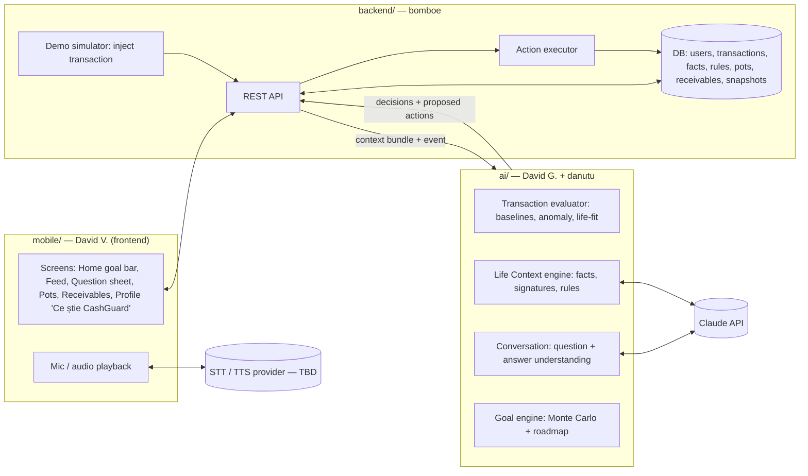
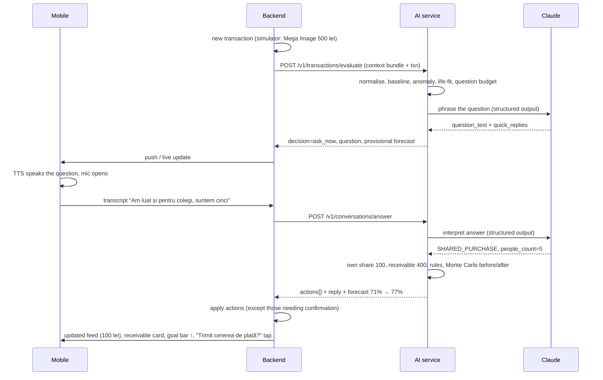

# 02 — System Architecture & End-to-End Flow

> Audience: whole team. Status: **proposal** — stacks marked "TBD" are not decided.

## 1. Components and owners



| Folder | Owner | Responsibility |
|---|---|---|
| `mobile/` | David V. | UI, voice capture/playback, rendering decisions/actions, confirmation taps |
| `backend/` | bomboe | persistence, auth (mock), transactions feed, demo simulator, executing actions, payment-request mock, calling the AI service |
| `ai/` (to be created) | David G. + danutu | everything in docs 03–06 and 09, exposed as the API in doc 07 |
| `docs/` | everyone | these documents |

## 2. The main loop (transaction → question → answer → re-plan)



## 3. Other flows

- **Volunteered context** — user presses the mic: "Merg în vacanță în august, cam 3.000 lei" →
  `/v1/context/volunteer` → `PLANNED_FUTURE_EVENT` → `create_pot` (needs one tap) + temporary
  fact + replan. Later travel spending is drawn from the pot, no anomaly.
- **Onboarding** — 6–8 short questions (job, who lives with you, housing, car, hobbies, big plans in
  the next 12 months, what matters to you, goal) + inference from the synthetic 6-month history →
  facts, hypotheses as 1-tap cards. Output: the first roadmap.
- **Profile screen "Ce știe CashGuard despre mine"** — every fact visible, editable, deletable;
  edits call `/v1/facts/signatures` and trigger a replan. This is the trust/transparency feature.
- **Agent chat** — "Îmi permit un PS5?" → `/v1/chat` → tools loop → answer with what-if numbers.

## 4. Where the "intelligence" lives

| Concern | Deterministic code | LLM (Claude) |
|---|---|---|
| Category, merchant, baselines, anomaly score | ✅ | — |
| Life-fit (signature matching) | ✅ | — |
| Turning a free-text life fact into signatures | — | ✅ (once per fact, cached) |
| Phrasing the question (tone) | template fallback | ✅ |
| Understanding the answer (intents, entities) | validation | ✅ |
| Money math (shares, pots, receivables) | ✅ | **never** |
| Goal probability & roadmap | ✅ | — |
| Explaining the change in words | template | ✅ (optional) |
| Executing actions | ✅ backend | **never** |

## 5. Voice pipeline (TBD — options)

Claude handles text only, so voice needs a separate speech provider.

```
mobile mic → audio → STT (ro-RO) → text → AI service → reply text → TTS (ro-RO) → mobile speaker
```

| Option | STT | TTS | Notes |
|---|---|---|---|
| A — device | OS speech recognition | OS TTS (e.g. `expo-speech` if Expo) | free, offline; Romanian quality depends on the phone |
| B — cloud | a hosted Whisper-class model or a cloud speech API with ro-RO | a cloud neural TTS with ro-RO voices | better quality, needs API keys, adds latency |

Decision needed: depends on the mobile stack and which API keys/credits we have at the hackathon.
**Demo safety:** always keep the quick-reply chips and a text field as fallback if the mic fails
(noisy hackathon stage!).

## 6. Suggested `ai/` layout (when we start coding)

```
ai/
  app/
    main.py                # FastAPI app, routes from doc 07
    schemas.py             # Pydantic models (ContextBundle, Transaction, Fact, Signature, ...)
    context/               # facts, signature library, life-fit, hypotheses       (doc 03)
    scoring/               # normalisation, baselines, anomaly, question policy   (doc 04)
    conversation/          # question generation, answer interpretation, actions  (doc 05)
    goals/                 # Monte Carlo, roadmap, options                         (doc 06)
    llm/                   # Claude client, prompts, structured output models      (doc 09)
  data/
    merchants.json
    signature_library.json
    personas/              # persona configs + generated transactions              (doc 08)
  scripts/generate_data.py
  tests/
```

Proposed stack: **Python 3.12 + FastAPI + Pydantic + numpy** (numpy for the Monte Carlo; Pydantic
models double as the structured-output schemas for Claude). To confirm with the team.
